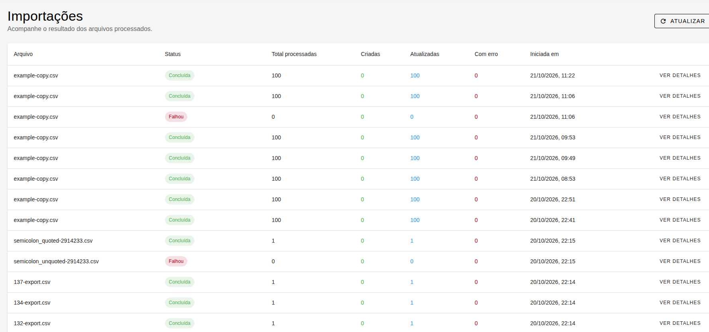
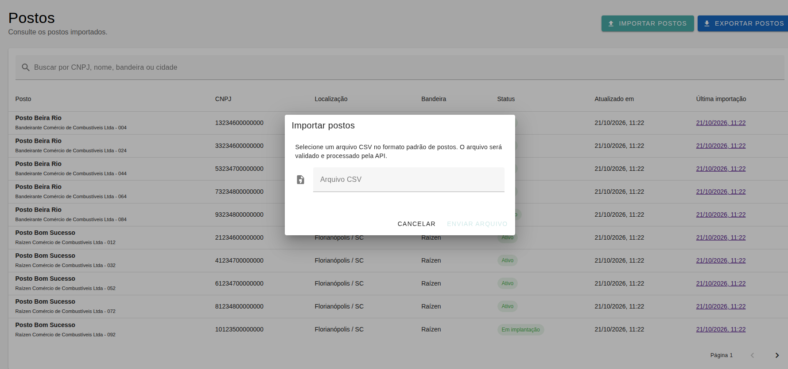
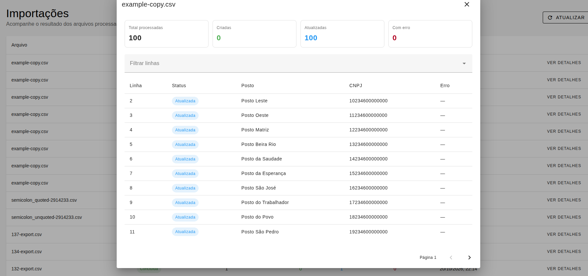
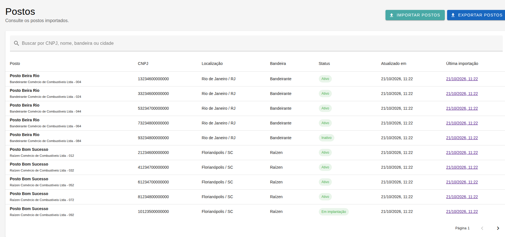
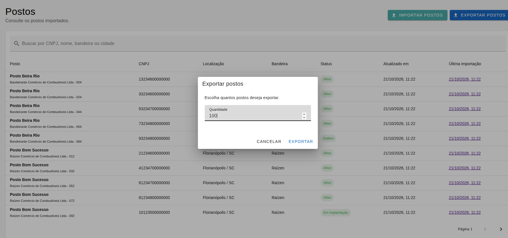
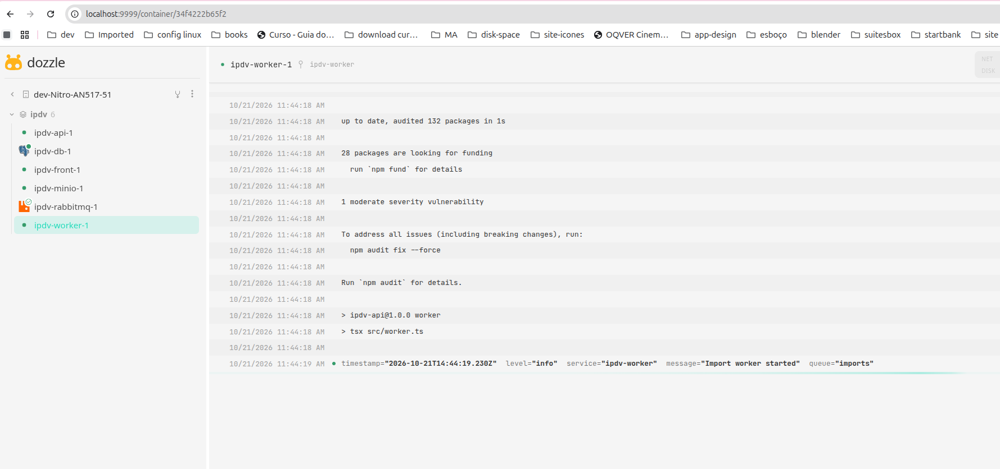

# Planilha de Postos

Aplicação para importar, consultar e exportar postos de combustível em CSV.

As decisões técnicas e de produto mais importantes estão documentadas em [`DECISOES.md`](DECISOES.md).

## Stack principal

- Node.js `22.23.2`;
- Backend em Express e TypeScript;
- PostgreSQL acessado pelo pacote `pg`;
- Frontend em Vue `3.5.22`;
- Interface com Vuetify `3.9.5`.

## Pré-requisitos

- Docker e Docker Compose;
- Git;
- Node.js 22 ou superior, caso queira executar os serviços fora do Docker.

## Iniciar do zero

Na raiz do projeto, execute:

```sh
cp .env.example .env
docker compose up -d --build
```

Depois que os containers estiverem em execução, prepare o banco:

```sh
docker compose run --rm api npm run db:migrate
docker compose run --rm api npm run db:seed:production
```

Para carregar um registro de demonstração, opcionalmente execute:

```sh
docker compose run --rm api npm run db:seed:fixtures
```

O fixture é destinado apenas a desenvolvimento e testes. Para testar a importação real, use um dos arquivos CSV documentados abaixo.

Reinicie a aplicacao:

```sh
docker compose up -d --build
```

Acesse a aplicação na url:

<http://localhost:5173/stations>

Acompanhe os logs na url:

<http://localhost:9999>

## Planilha modelo

O arquivo modelo, sem dados preenchidos, está disponível em [`docs/csv-example.csv`](docs/csv-example.csv). Use-o como referência para criar novos arquivos.

Para testar a importação com várias linhas já preenchidas, use [`docs/csv-with-data.csv`](docs/csv-with-data.csv).

O arquivo deve manter:

- o delimitador `;`;
- o header original;
- a ordem das colunas;
- a lista de combustíveis separada por vírgulas dentro do campo `combustiveis`.

### Realizar importação pela interface

1. Acesse <http://localhost:5173/stations>.
2. Clique em **Importar postos**.
3. Selecione `docs/csv-with-data.csv` ou `docs/csv-example.csv`.
4. Envie o arquivo e acompanhe o resultado do processamento.

### Realizar importação pela API

Na raiz do projeto, execute:

```sh
curl -i -F file=@docs/csv-with-data.csv http://localhost:3261/imports
```

## Acessos locais

| Serviço | Endereço |
| --- | --- |
| Aplicação | <http://localhost:5173> |
| API | <http://localhost:3261> |
| Healthcheck | <http://localhost:3261/health> |
| Logs (Dozzle) | <http://localhost:9999> |
| RabbitMQ | <http://localhost:15673> |
| MinIO | <http://localhost:9001> |

Credenciais do RabbitMQ (fila):

```text
usuário: ipdv
senha: ipdv
```

## Acompanhar o processamento

A API retorna `202 Accepted` quando o arquivo é colocado na fila. O processamento pode ser acompanhado na aplicação, no Dozzle ou com:

```sh
docker compose logs -f api worker rabbitmq
```

Os arquivos devem manter o delimitador `;`, o header original e a ordem das colunas. O campo `combustiveis` usa vírgulas para separar os combustíveis.

## Parar o projeto

Para parar os containers e preservar os dados:

```sh
docker compose down
```

Para parar e remover também os volumes do banco, RabbitMQ, MinIO e logs:

```sh
docker compose down -v
```

## Screenshots

### Lista de importações



### Modal de importação



### Detalhes da importação



### Lista de postos



### Modal de exportação



### Página de logs


